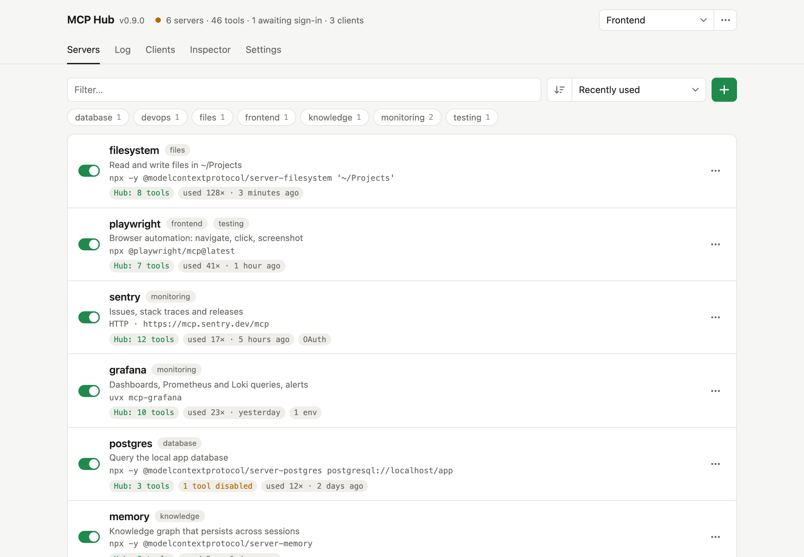

# MCP Hub

[](https://github.com/endorfin/mcp-hub/actions/workflows/tests.yml)
[](https://github.com/endorfin/mcp-hub/releases/latest)
[](LICENSE)


**Set up your MCP servers once, use them in every client.** A local hub that manages all your servers in one place, tests them, and serves them bundled behind a single endpoint to Claude Code, Claude Desktop, Codex, Copilot, Cursor and VS Code.

<picture>
  <source media="(prefers-color-scheme: dark)" srcset="docs/screenshot-dark.png">
  
</picture>

No dependencies besides Python 3.11+. The server only listens on `127.0.0.1`. The interface is available in English and German (see “GUI”).

## Why

Every MCP client keeps its own list of servers. Add a server and you edit four config files; rotate a token and you hunt it down in all of them, usually in plain text. Each client then loads every tool definition into its context on every request, which with a dozen servers means tens of thousands of tokens before you have typed anything.

MCP Hub turns that around: servers live in one place, secrets stay in the keychain, and every client gets a single entry pointing at the hub, connected with a click.

## Features

- **One endpoint for every client:** stdio, Streamable HTTP and SSE servers bundled at `http://127.0.0.1:4747/mcp`, tool names prefixed `server__tool`.
- **Connect and import with a click:** add the hub to Claude Code, Claude Desktop, Codex, Cursor, VS Code or Copilot CLI, and move their existing servers over (JSON, Codex TOML, `mcp add` commands).
- **Compact mode:** clients get `search_tools`, `describe_tool` and `call_tool` instead of every definition, about 300 instead of 60,000 tokens with 200 tools.
- **Profiles:** switch between setups in one click, or give each client its own profile endpoint.
- **Secrets without plain text:** `${keychain:…}`, `${op://…}` (1Password) and `${env:…}` references, plus OAuth for remote servers with tokens in the keychain.
- **Inspector, call log and statistics:** call any tool by hand, see every call with client, duration and result.
- **Runs itself:** crashed servers restart with growing delays, live `list_changed` notifications, updates with one click, autostart at login.
- **macOS, Linux and Windows**, tested in CI on all three.

## Contents

- [Getting started](#getting-started)
- [Files](#files)
- [Server entries](#server-entries): [importing](#importing), [OAuth](#oauth), [secrets](#secrets)
- [Hub](#hub): [compact mode](#compact-mode), [connecting clients](#connecting-clients), [live updates](#live-updates)
- [Autostart](#autostart) · [Updates](#updates)
- [GUI](#gui): [profiles](#profiles), [statistics](#statistics), [usage and call log](#usage-and-call-log)
- [API](#api) · [Tests](#tests) · [Troubleshooting](#troubleshooting) · [Contributing](#contributing) · [License](#license)

## Getting started

**Requirements:** Python 3.11 or newer, on macOS, Linux or Windows. On Linux, keychain secrets and OAuth tokens need the Secret Service (GNOME Keyring or KWallet) and `secret-tool` (package `libsecret-tools`); the autostart needs systemd. On Windows they use the Credential Manager and a scheduled task, both built in. On Windows, run `python` or `py` wherever this README says `python3`.

**1. Install and run** – clone the repository (or download the [latest release](https://github.com/endorfin/mcp-hub/releases/latest)) and start it. There is nothing to build and nothing to install with pip.

```bash
git clone https://github.com/endorfin/mcp-hub.git && cd mcp-hub && python3 app.py
```

Then open the GUI at http://127.0.0.1:4747. The hub endpoint for your clients is `http://127.0.0.1:4747/mcp`. Use `PORT=…` or `--port …` for a different port.

**2. Add servers** – click **+** → “Import…” and pick an installed client to take over its servers, or paste an existing configuration: JSON from Claude Desktop, Claude Code, Cursor or VS Code, TOML from Codex, or `claude mcp add` / `codex mcp add` commands (see [Importing](#importing)). “Add server…” creates one by hand.

**3. Connect your clients** – Settings → “Connect clients” adds the hub to each installed client with one click. By hand, each client only needs this one entry, see [Connecting clients](#connecting-clients):

```bash
claude mcp add --scope user --transport http mcp-hub http://127.0.0.1:4747/mcp
```

**4. Start at login** – so your clients find the hub after a reboot, stop the hub from step 1 (Ctrl+C) and register it with [`autostart.sh`](#autostart) (a LaunchAgent on macOS, a systemd user service on Linux) or `autostart.ps1` on Windows (a scheduled task); it starts right away and on every login:

```bash
./autostart.sh install
```

```powershell
.\autostart.ps1 install
```

To update, use the green “… available” chip in the header (see [Updates](#updates)), or `git pull` followed by `./autostart.sh restart`.

## Files

Everything lives in `~/.config/mcp-hub/` (on Windows `%APPDATA%\mcp-hub\`; override with `MCP_HUB_HOME`), not in the repository.

| File | Contents |
| --- | --- |
| `servers.json` | Server definitions in `mcpServers` format; `servers.json.bak` is written before every change |
| `gui-settings.json` | Path to the server file, `passEnvironment`, `language`, `checkUpdates` |
| `usage.json` | Usage counter per server (count, last call) |
| `calls.jsonl` | Call log, the last 5,000 entries |
| `profiles.json` | Saved profiles and the active profile |
| `clients.json` | Session ID → client mapping, the last 300 sessions |
| `update.json` | Result of the last update check |

Tokens either sit in `servers.json` or, better, as a reference to the keychain or 1Password (see “Secrets”). `servers.json` does not belong in a repository.

## Server entries

Local commands (stdio):

```json
"grafana": { "command": "uvx", "args": ["mcp-grafana"], "env": { "GRAFANA_URL": "…" } }
```

Remote servers via Streamable HTTP or SSE:

```json
"timing-sync-mcp": { "type": "http", "url": "https://…/mcp", "headers": { "Authorization": "Bearer …" } },
"openbrain": { "type": "sse", "url": "http://…/sse?key=…" }
```

An entry with `url` and no `type` is treated as Streamable HTTP. Optional fields:

- `description`: what the server is for, shown in the GUI only. Without it, the GUI shows the server’s own description or its first tools.
- `enabled: false`: the server stays in the list, but the hub does not start it.
- `disabledTools`: list of tool names (without prefix) that the hub hides and refuses to call. Easiest to manage via ⋯ → “Choose tools…”: the dialog lists all tools with a short description, can be filtered, and “All on” / “All off” only affect the filtered tools (e.g. filter “incident”, then “All off”). The list then shows a chip in orange text, e.g. “6 tools disabled”; its tooltip names the tools and a click opens the dialog. A change does not restart the server.
- `enabledTools`: allow list of tool names; only these are offered (applied before `disabledTools`). The “Choose tools…” dialog converts it into `disabledTools` when you save.
- `cwd` (stdio): working directory for the server; `~` is expanded. Without it, local servers run in the hub folder.
- `env` (stdio) or `headers` (HTTP/SSE).

### Importing

“Import…” detects the format by itself; you only paste. A preview shows the detected format, the servers, which existing entries will be replaced and what cannot be carried over.

**From installed clients:** the dialog also lists the clients from “Connect clients” that have servers of their own (“Codex · 7”); a click loads them into the preview, without the client’s other settings. With “Remove the imported servers from … afterwards” the hub deletes the imported entries from that client after importing them (with a backup), so the move to the hub is a single step. The “own servers” chip in Settings opens the same view.

| Paste | Source |
| --- | --- |
| `{ "mcpServers": { … } }` | Claude Desktop, Claude Code (`~/.claude.json`), Cursor, Copilot |
| `{ "servers": { … } }` | VS Code (`.vscode/mcp.json`) |
| `{ "name": { "command": … } }` | Bare server objects |
| `[mcp_servers.<name>]` tables | Codex (`~/.codex/config.toml`) |
| `claude mcp add …` / `claude mcp add-json …` / `codex mcp add …` | Setup instructions, one command per line |

Codex fields map as follows: `command`, `args`, `env`, `cwd`, `url`, `enabled`, `enabled_tools` and `disabled_tools` carry over directly; `http_headers` become `headers`; `bearer_token_env_var` and `env_http_headers` become headers with `${env:…}` references; the `oauth` table (`client_id`, `client_secret`) and `scopes` go to `oauth`. Client-side settings (`startup_timeout_sec`, `tool_timeout_sec`, approval modes, `required`) and `http_headers_helper` are dropped, and `env_vars` is replaced by the hub’s `passEnvironment`; the preview lists every dropped key. Entries that point to the hub itself (e.g. the `mcp-hub` entry of your Claude configuration) are skipped. Tokens from other clients cannot be transferred: sign in again in the hub.

### OAuth

Remote servers that require OAuth only need their URL; no token in a header is needed. When the server answers `401`, the list shows “Sign-in required – sign in”. A click opens the provider’s sign-in page in a new window.

The flow follows the MCP specification: the hub discovers the authorization server via Protected Resource Metadata (RFC 9728) and Authorization Server Metadata (RFC 8414), registers itself as a client (RFC 7591) and signs in using the authorization code flow with PKCE (S256) and the `resource` parameter. The provider redirects back to `http://127.0.0.1:4747/oauth/callback`.

- Access and refresh tokens are stored in the keychain under `mcp-hub/oauth/<server>` (macOS keychain, Secret Service on Linux, Credential Manager on Windows), never in `servers.json`.
- When a token expires, the hub fetches a new one with the refresh token and retries the call; clients never notice.
- Signed-in servers carry an “OAuth” chip (tooltip: validity). ⋯ → “Sign out” deletes the token.
- If the entry already has an `Authorization` header, the hub uses it instead of OAuth.

**Providers without automatic registration** (e.g. GitHub): create an OAuth app with the provider, set `http://127.0.0.1:4747/oauth/callback` as its callback URL and enter the client ID (and secret, if required) in the editor under “OAuth”. The lock moves the secret into the keychain. If the provider offers no discovery, add the authorization and token URLs:

```json
"github": {
  "type": "http",
  "url": "https://api.githubcopilot.com/mcp/",
  "oauth": { "clientId": "Iv1.…", "clientSecret": "${keychain:github/oauth-client-secret}", "scopes": "repo read:user" }
}
```

Available fields: `clientId`, `clientSecret`, `scopes`, `authorizationUrl`, `tokenUrl` and `tokenAuth` (`client_secret_post`, the default, or `client_secret_basic`). If a provider without registration is missing a client ID, the error message on sign-in explains what to do.

### Secrets

Instead of plain-text tokens, values in `env`, `headers`, `url`, `args` and `cwd` can contain references that the hub only resolves when it starts a server:

```json
"glitchtip": { "type": "http", "url": "https://…/mcp", "headers": { "Authorization": "${keychain:glitchtip/Authorization}" } },
"grafana": { "command": "uvx", "args": ["mcp-grafana"], "env": { "GRAFANA_SERVICE_ACCOUNT_TOKEN": "${op://Private/Grafana/token}" } }
```

`${env:NAME}` takes a value from the hub’s environment, e.g. `"Authorization": "Bearer ${env:GITHUB_TOKEN}"`.

The notation alone decides the source, per value. There is no setting and no fallback: if `op` is not signed in, the hub does not look in the keychain instead. A server may mix both sources.

- `${keychain:name}` reads the keychain: on macOS the login keychain (account `mcp-hub`, service `mcp-hub/<name>`; searching for `mcp-hub` in Keychain Access lists all entries), on Linux the Secret Service with the attributes `service mcp-hub/<name>` and `account mcp-hub` (visible in Seahorse or KWallet). The easiest way is the lock next to a value in the editor: it creates the entry and replaces the value with the reference; nothing is written to the file until you click “Save”. By hand on macOS: `security add-generic-password -a mcp-hub -s mcp-hub/<name> -w` (printable ASCII values only; `security` returns anything else as hex). On Linux: `secret-tool store --label="MCP Hub: <name>" service mcp-hub/<name> account mcp-hub`. On Windows the entries are generic credentials named `mcp-hub/<name>` in the Credential Manager (“Windows Credentials”); values over 2 KB are split into `mcp-hub/<name>#1`, `#2` and so on.
- `${op://vault/item/field}` reads via the 1Password CLI (`op read`). `op` must be signed in within the hub’s environment, e.g. through the 1Password app integration. The hub never writes to 1Password; the lock always writes to the keychain. Useful for tokens that are already maintained, shared or rotated in 1Password; otherwise the keychain is simpler.
- References may be part of a longer value, such as `Bearer ${keychain:…}` or `?key=${keychain:…}`.
- Resolved values stay in memory until the hub restarts. After changing a value in the keychain or 1Password, restart the hub (e.g. `./autostart.sh restart`); switching the server off and on is not enough. Only the lock in the GUI refreshes its own entry immediately.
- If an entry is missing, the server does not start. The tooltip on the status chip then shows e.g. “Secret: No keychain entry …”.

With `passEnvironment` (Settings), local servers inherit the hub’s environment; otherwise they only get `env`.

## Hub

At `/mcp`, the hub bundles all enabled servers into one MCP endpoint (Streamable HTTP, JSON responses).

- **Names:** tools and prompts get the server name as a prefix (`grafana__query_loki_logs`); resources keep their URI.
- **Titles:** every tool gets the title `server: Name`. Claude Desktop only shows the title in its connector permissions, so you can still tell which server a tool belongs to.
- **Changes:** saving in the GUI syncs the hub immediately. Only servers whose command, URL, headers or environment changed are restarted. Changing just the description restarts nothing.
- **Crashes:** a server that stops unexpectedly, or fails to start, is restarted after 2, 4, 8, 16 and 32 seconds. After five failures in a row the hub gives up and the server list offers “Try again”; a server that ran for at least a minute starts counting from zero. The server list shows how often a server was restarted and the last error. Clients get a `list_changed` notification when its tools disappear and again when they are back.
- **Processes:** local servers run in their own process group. On shutdown, the hub cleans up the whole group, child processes included.
- **Working directory:** local servers run in the hub folder, so tools that expect a project path need an absolute path.
- **Security:** write requests (`POST`, `PUT`) with a foreign `Origin` header are rejected, for the MCP endpoint and the GUI API alike (protection against DNS rebinding and CSRF).
- **Messages:** error messages from the hub and its API are in English, since agents read them too. The GUI translates the common ones when German is selected.

### Compact mode

Every client loads the definitions of all tools into its context, for every request. With a dozen servers that quickly adds up to tens of thousands of tokens and makes it harder for the model to pick the right tool. At `/mcp/compact` (and `/p/<profile>/mcp/compact`), the hub offers just three tools instead:

| Tool | Purpose |
| --- | --- |
| `search_tools` | Finds tools by what you want to do (`query`, optionally `server` and `limit`); returns names with a one-line description |
| `describe_tool` | Full description and input schema of one tool |
| `call_tool` | Calls a tool by name with its `arguments` |

The search is a weighted keyword search over tool names, titles, descriptions, parameter names and the server descriptions, with prefix matching and without filler words; it runs locally, without an index or a model. The `initialize` instructions list the servers with their descriptions, so the model knows what is available. Disabled tools, profiles and the call log work as on the normal endpoint, and calls show up in the log with the real tool name.

In the GUI, the “Compact mode” switch in the hub endpoint card (Settings) changes all connect snippets to the compact URL and shows the estimated tool definition size for both modes. Each client decides by its URL, so you can connect one client compactly and another with every tool.

### Connecting clients

**By click:** Settings → “Connect clients” lists Claude Code, Claude Desktop, Codex, Cursor, VS Code and Copilot CLI with the configuration file the hub found for each, and whether the hub is already in it. “Connect” adds the hub (with the compact URL when the compact switch is on), “Disconnect” removes it, and a connected client can be switched between compact and all tools. Before every change the hub writes a backup next to the file (`*.mcp-hub.bak`). Claude Code is changed through `claude mcp add/remove --scope user`, so the `claude` command must be on the hub’s `PATH`; Claude Desktop gets the `bridge.py` entry and needs a restart afterwards. JSON files with comments are left alone; edit those by hand.

| Client | File |
| --- | --- |
| Claude Code | `~/.claude.json` (via the `claude` CLI) |
| Claude Desktop | `~/Library/Application Support/Claude/claude_desktop_config.json`, `%APPDATA%\Claude\…`, `~/.config/Claude/…` |
| Codex | `~/.codex/config.toml` (or `$CODEX_HOME`) |
| Cursor | `~/.cursor/mcp.json` |
| VS Code | `…/Code/User/mcp.json` in the same application support folder as Claude Desktop |
| Copilot CLI | `~/.copilot/mcp-config.json` |

**By hand:**

Claude Code:

```bash
claude mcp add --scope user --transport http mcp-hub http://127.0.0.1:4747/mcp
```

Codex:

```bash
codex mcp add mcp-hub --url http://127.0.0.1:4747/mcp
```

or in `~/.codex/config.toml`:

```toml
[mcp_servers.mcp-hub]
url = "http://127.0.0.1:4747/mcp"
```

Copilot / VS Code (`~/.copilot/mcp-config.json`):

```json
{ "mcpServers": { "mcp-hub": { "type": "http", "url": "http://127.0.0.1:4747/mcp", "tools": ["*"] } } }
```

Claude Desktop can only start local commands. For that, the repository ships `bridge.py`, a dependency-free bridge from stdio to the hub (`~/Library/Application Support/Claude/claude_desktop_config.json`; the GUI shows the matching snippet with absolute paths under Settings):

```json
{ "mcpServers": { "mcp-hub": { "command": "/opt/homebrew/bin/python3", "args": ["/path/to/mcp-hub/bridge.py", "http://127.0.0.1:4747/mcp"] } } }
```

The bridge forwards the hub’s notifications to Claude Desktop and re-initializes on its own after the hub restarts. If the hub is not reachable, it answers requests with an error instead of hanging. [mcp-proxy](https://github.com/sparfenyuk/mcp-proxy) works as well but does not forward notifications.

### Live updates

When the tool list changes (server on/off, tools deselected, profile switched, a server reports new tools itself), the hub sends `notifications/tools/list_changed` (likewise for prompts and resources). Clients receive it over an open SSE stream (`GET /mcp` with `Accept: text/event-stream`) that they open right after `initialize`.

- **Claude Code and VS Code/Copilot** support this. Changes arrive without reconnecting.
- **Indicator:** the GUI header counts the clients with an open stream (“· 2 clients”); the tooltip names them.
- **Claude Desktop** via `bridge.py`: the bridge keeps the stream open and forwards the notifications. With mcp-proxy as the bridge they are lost, and only restarting Claude Desktop helps.
- **Hub restart:** sessions only last until the hub restarts. Afterwards, the hub answers old session IDs with `404` and clients initialize again (as the MCP specification requires). `DELETE /mcp` ends a session.

## Autostart

For Claude Code, Claude Desktop and Copilot to have their tools after a reboot, the hub needs to start at login. `autostart.sh` runs `python3 app.py` at login and restarts it after a crash: on macOS as a LaunchAgent (`~/Library/LaunchAgents/io.github.endorfin.mcp-hub.plist`), on Linux as a systemd user service (`~/.config/systemd/user/mcp-hub.service`). On Windows, `autostart.ps1` registers the scheduled task “MCP Hub”, which starts `pythonw app.py` without a console window at login and restarts it every minute after a crash:

```bash
./autostart.sh install     # set up and start right away
./autostart.sh status      # set up? is the hub running?
./autostart.sh restart     # restart the hub, e.g. after a keychain change
./autostart.sh uninstall   # remove and stop the hub
```

```powershell
.\autostart.ps1 install     # same commands: install, status, restart, uninstall
```

If PowerShell refuses to run the script, allow it once for the session with `Set-ExecutionPolicy -Scope Process Bypass`. Depending on the Windows edition and its policies, registering a task that starts at login may need an administrator PowerShell.

Log: `~/Library/Logs/mcp-hub.log` on macOS, `journalctl --user -u mcp-hub` on Linux, `%LOCALAPPDATA%\mcp-hub\mcp-hub.log` on Windows. On Linux, the user service runs while you are logged in; `loginctl enable-linger` keeps it running without a session. The path to `python3`, `PATH` and `PORT` are captured at install time; after moving the repository or installing a new Python, run `install` again. If a hub is already running on the port, the script aborts instead of starting a second one.

## Updates

When the GUI opens, the hub asks GitHub for the latest release of `endorfin/mcp-hub` (at most every 12 hours; the result is cached in `update.json`). If it is newer than the installed version, a green chip appears next to the version number in the header. A click shows the release notes and offers “Update now”:

- **Git clone:** `git fetch --tags`, then a fast-forward to the release tag. If the checkout has local changes or commits that are not part of the release, the hub stops and leaves the update to you.
- **Release archive:** the hub downloads the release archive from GitHub and unpacks it over the program folder. Your configuration lives in `~/.config/mcp-hub/` and is not touched.

Afterwards the hub stops its servers and restarts itself in the same process, so prun, launchd or a terminal session keep running it. Connected clients initialize again on their own; the GUI reloads once the new version answers.

The check is the only request the hub sends on its own. Turn it off in the settings (“Check GitHub for new versions”); “Check now” runs it manually.

## GUI

Design rules and components of the interface are documented in [DESIGN.md](DESIGN.md); audience, purpose and principles of the product in [PRODUCT.md](PRODUCT.md).

- **Servers:** list with on/off switch, hub status per server (tools, errors), usage, and sorting by recently used, name or file order in both directions. The ⋯ menu inspects a server, chooses its tools for the hub, edits, duplicates and deletes it. Import accepts JSON, Codex TOML and `mcp add` commands from other configurations.
- **Log:** every call through the hub with time, client, server, tool, arguments, result preview, duration and error status. Filter by server, client and errors.
- **Clients:** every session since the last hub start with client name and version, profile endpoint, compact mode, live stream, connection time, last activity and number of calls. “Show in log” opens the log filtered to that client. Clients that never sign off and have no stream are marked idle after 10 minutes.
- **Inspector:** connects directly to a server (independent of the hub) and lists tools, resources, templates and prompts. Everything can be called with form or JSON input; stderr and notifications appear below.
- **Settings:** path to the server file, language, `passEnvironment`, the update check; the hub endpoint with the compact switch and connect snippets for Claude Code, Claude Desktop, Codex and Copilot / VS Code; and the complete `mcpServers` definition as JSON for direct editing.

**Language:** English or German, chosen under Settings → Language. “Automatic (browser)” follows the browser language. The choice is stored in `gui-settings.json`; it also decides the language of the OAuth return page.

### Profiles

A profile remembers, per server, whether it is enabled and which tools are deselected. It lets you switch quickly between setups, such as “Frontend” with nuxt, nuxt-ui and chrome-devtools, or “Ops” with grafana and glitchtip.

- **Save:** set up servers and tools, then ⋯ → “Save as new profile…” at the top.
- **Switch:** open the profile picker at the top (with search field, arrow keys and Enter) and choose a profile. The hub writes on/off and `disabledTools` to `servers.json`, starts or stops the affected servers and hides tools. Connected clients receive the new tool list automatically (see “Live updates”).
- **Modified:** when the current state differs from the active profile, the picker shows an orange dot (tooltip: unsaved changes). ⋯ → “Update …” stores the current state in the profile. Switching with unsaved changes asks first.
- **No profile:** turns on all servers and enables all tools (removes every `disabledTools`), even if “No profile” is already selected. Clicking a modified profile again resets it to its saved state.
- **New servers:** servers a profile does not know are left unchanged by a switch. “Update” adds them to the profile.
- **Manage:** under ⋯ → “Manage profiles…”, each profile has its own ⋯ menu: copy URL, activate, rename and delete, without applying it first. Clicking the URL copies it as well. Servers and tools stay as they are. Names must not contain `/`.

The profile selected at the top applies to the whole hub, i.e. to all clients on the default endpoint `/mcp`.

**Endpoint per profile:** each profile is also available at `http://127.0.0.1:4747/p/<profile>/mcp` (copy the URL in “Manage profiles…”). A client there always sees that profile’s servers and tools, regardless of which profile is active at the top. That way, Copilot can work with “Frontend” only while Claude Code gets everything:

```bash
claude mcp add --scope user --transport http mcp-hub-frontend http://127.0.0.1:4747/p/Frontend/mcp
```

If the profile contains a server that is switched off in the hub, the hub starts it on demand as soon as a client asks at that profile endpoint, and stops it again after 10 minutes without use (`MCP_HUB_ON_DEMAND_IDLE` in seconds). The normal endpoint never sees such a server; the server list marks it as “running for a profile endpoint”. That way rarely used servers stay off in the hub and still serve the profiles that need them. Servers the profile does not know appear with their current setting. The log shows the profile after the client, e.g. `claude-code · Frontend`.

### Statistics

Above the call log, a collapsible statistics panel shows key figures (calls, error rate, typical duration, clients), calls per day for the last 14 days including errors, a table per server (calls, errors, median, p95, last call; a click filters the log) and the five slowest tools by p95. It is based on the last 5,000 calls in `calls.jsonl`.

### Usage and call log

Only real calls are counted (`tools/call`, `prompts/get`, `resources/read`), not list requests. In the log, arguments are truncated to 4,000 and results to 600 characters.

The hub identifies the client from `clientInfo` during `initialize` and assigns it an `Mcp-Session-Id`. Requests without a session ID appear as `<user agent> (no session)`.

## API

| Method | Path | Purpose |
| --- | --- | --- |
| `GET` | `/api/state` | Configuration and settings |
| `PUT` | `/api/servers` | Save `{"mcpServers": {…}}` and sync the hub |
| `PUT` | `/api/settings` | Save settings |
| `GET` | `/api/hub` | Status per server (state, error, number of tools/prompts/resources, OAuth status) |
| `GET` | `/api/hub/tools?name=` | All tools of a server with their `enabled` state |
| `GET` | `/api/live` | Clients with an open notification stream |
| `POST` | `/api/hub/restart` | `{"name"}`: restart a server in the hub right away and reset its restart counter |
| `GET` | `/api/integrations` | Known clients with configuration file, `installed`, `connected`, `compact` and their own servers (`importable`) |
| `POST` | `/api/integrations/connect`, `/disconnect` | `{"id", "compact"}`: add the hub to a client or remove it |
| `POST` | `/api/integrations/export` | `{"id"}`: the client’s own servers as text for the import parser |
| `POST` | `/api/integrations/remove` | `{"id", "names"}`: delete these servers from the client |
| `GET` | `/api/compact` | Size of the tool definitions as JSON characters, `fullChars` and `compactChars` |
| `GET` | `/api/clients` | Sessions since the hub start: name, version, profile, `since`, `lastSeen`, `requests`, `calls`, `streams` |
| `GET` | `/api/update` | Installed and latest version, release notes, install method; checks GitHub in the background when the last check is older than 12 hours |
| `POST` | `/api/update/check` | Check GitHub now |
| `POST` | `/api/update/apply` | Install the latest release and restart the hub |
| `GET` | `/api/usage` | Usage counter |
| `GET` | `/api/calls?limit=300` | Recent calls (max. 1,000) |
| `GET` | `/api/stats?days=14` | Call statistics (key figures, per day, per server, slowest tools) |
| `POST` | `/api/oauth/start` | `{"name"}`: start sign-in, returns the sign-in page `{"url"}` |
| `POST` | `/api/oauth/logout` | `{"name"}`: delete the token |
| `GET` | `/oauth/callback` | Return from the authorization server |
| `POST` | `/api/profiles` | `{"action": "save" \| "apply" \| "rename" \| "delete" \| "clear", "name", "newName"}`; `clear` enables everything |
| `POST` | `/api/import/parse` | `{"text"}`: detect and convert a configuration, returns `format`, `servers`, `warnings`, `skipped`, `existing` |
| `POST` | `/api/secrets` | Store `{"name", "value"}` in the keychain, returns `{"ref"}` |
| `POST` | `/api/inspect/connect` | Open an inspector session (`{"name": …}`) |
| `POST` | `/api/inspect/call` | Send `{"name", "method", "params"}` to the server |
| `POST` | `/api/inspect/disconnect` | Close the session |
| `GET` | `/api/inspect/log?name=&since=` | stderr and notifications of the session |
| `POST` | `/mcp` | The hub’s MCP endpoint |
| `GET` | `/mcp` | SSE stream for notifications (`Accept: text/event-stream`) |
| `POST` | `/p/<profile>/mcp` | MCP endpoint with a fixed profile (`GET` for the stream as well) |
| `POST` | `/mcp/compact`, `/p/<profile>/mcp/compact` | The same endpoints in compact mode (`search_tools`, `describe_tool`, `call_tool`) |

## Tests

```bash
python3 -m unittest discover -s tests -v
```

`tests/test_importer.py` covers the import parser (JSON variants, Codex TOML, `mcp add` commands). `tests/test_integrations.py` covers connecting, switching and disconnecting clients in a temporary home folder (JSON clients, the Codex TOML with subtables and quoted names, refusing files with comments or inline tables), plus exporting and removing their servers. `tests/test_compact.py` covers the compact mode search (ranking, prefixes, filler words, server filter). `tests/test_updater.py` covers the update check against a fake GitHub API, the fast-forward of a git checkout (and refusing one with local changes or commits) and installing a release archive, including rejecting unsafe archive paths. The other tests start their own hub with its own configuration folder on a free port and two instances of a small stdio server (`tests/dummy_server.py`). They cover prefixes and titles, sessions (404 after ending), restarting a crashed server and the restart delays, starting switched-off servers on demand for a profile endpoint, the bridge including a hub restart, routing and logging, errors, `disabledTools`, profiles including profile endpoints, notifications, origin protection, statistics and (macOS only) keychain resolution, plus the complete OAuth flow against a test provider (`tests/dummy_oauth_server.py`: sign-in, refreshing an expired token, sign-out; once with automatic registration, once with a fixed client ID and secret). Your real configuration stays untouched; the keychain tests create `mcp-hub/selftest/hub-tests` and `mcp-hub/oauth/selftest-oauth` and delete them again. Without a usable keychain (no Secret Service on Linux, for example) those tests are skipped. GitHub Actions runs the suite on macOS, Ubuntu and Windows with Python 3.11 and 3.13, with a temporary keychain on macOS, GNOME Keyring on Ubuntu and the Credential Manager on Windows, so the keychain and OAuth tests run everywhere; on Windows it also registers and removes the scheduled task.

## Troubleshooting

- **Server shows “error”:** hover over the status chip; the tooltip shows the error message including the last stderr line. For more detail, use the inspector, which starts the same entry directly.
- **Tool missing in the client:** is the server enabled and green in the hub? Then reconnect the client.
- **Orphaned processes:** processes left over after a client quits usually come from clients that only end the top-level process. The hub itself ends whole process groups. Check with `ps -axo pid,ppid,command | grep <server>`.
- **Port in use:** `lsof -iTCP:4747 -sTCP:LISTEN`. Set a different port with `PORT=…`, but then update the client URLs too.

## Contributing

See [CONTRIBUTING.md](CONTRIBUTING.md) for setup, tests, code style and the translation rules.

## License

[MIT](LICENSE)
